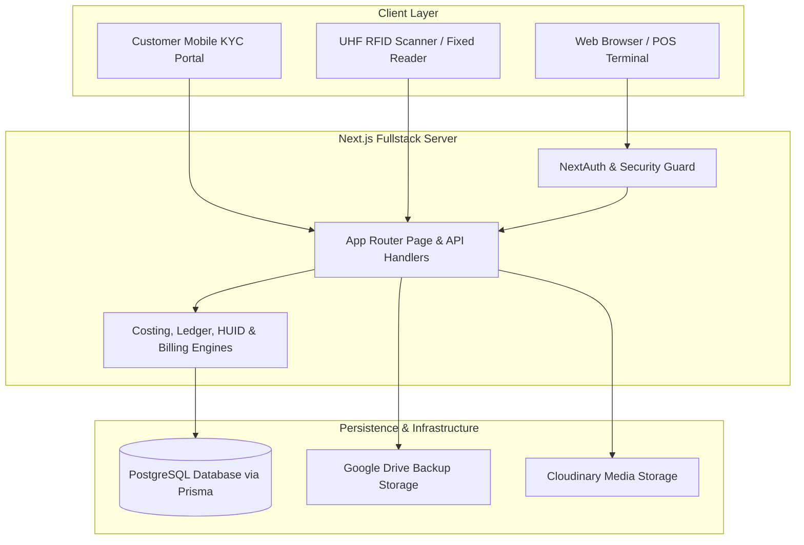
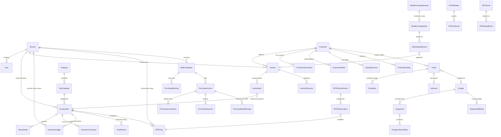

# 💎 Jewelry Store Management ERP — Comprehensive System Architecture & Technical Documentation

---

## 📑 Table of Contents
1. [Executive Summary & System Architecture](#1-executive-summary--system-architecture)
2. [All Frontend Panels & Dashboards](#2-all-frontend-panels--dashboards)
3. [Core Business Functionalities & Domain Engines](#3-core-business-functionalities--domain-engines)
4. [Complete Routes Directory](#4-complete-routes-directory)
   - [4.1 Frontend Page Routes (56 Routes)](#41-frontend-page-routes-56-routes)
   - [4.2 Backend API Routes (242 Endpoints)](#42-backend-api-routes-242-endpoints)
5. [Database Schema Dictionary (All 132 Prisma Models)](#5-database-schema-dictionary-all-132-prisma-models)
6. [Schema Relationship Architecture & Entity-Relationship Maps](#6-schema-relationship-architecture--entity-relationship-maps)

---

# 1. Executive Summary & System Architecture

The **Jewelry Store Management ERP** is an enterprise-grade, multi-branch, omni-channel software system custom-tailored for retail showrooms, manufacturing workshops, bullion traders, and wholesale jewelry enterprises.

### Core Technology Stack
- **Frontend & App Framework**: Next.js (App Router, Server Components, Route Handlers)
- **Language & Runtime**: TypeScript, Node.js
- **Database & ORM**: PostgreSQL with Prisma ORM (132 relational schema models)
- **Authentication & Security**: NextAuth.js (JWT sessions, multi-role RBAC, 2FA TOTP, IP Whitelisting, reCAPTCHA Enterprise)
- **UI Architecture**: Tailwind CSS, Shadcn UI, Tabler Icons, Lucide Icons, Recharts
- **Hardware Integration**: UHF RFID Readers (TCP/IP socket & HTTP gateway listeners), Zebra/TSC Barcode label printers, digital weighing scale interfaces
- **External Services**: Google Drive API (cloud database backups), Cloudinary (asset & KYC document storage), SMTP Nodemailer (transactional emails)

---

# 2. All Frontend Panels & Dashboards

The ERP interface is divided into functional operational hubs accessible via the global responsive sidebar (`app-sidebar.tsx`) and scoped by user role (`SUPER_ADMIN`, `ADMIN`, `MANAGER`, `SALESMAN`, `KARIGAR`).

### 1. Multi-Role Executive Dashboards (`/dashboard`)
- **Master Switcher Dashboard (`/dashboard`)**: Detects active session permissions and redirects staff to role-specific layouts.
- **Admin Dashboard (`/dashboard/admin`)**: Real-time business intelligence metrics including total store turnover, gross profit margins, daily bullion exposure, branch-wise comparative sales, top-performing product categories, and system health.
- **Store Manager Dashboard (`/dashboard/manager`)**: Day-to-day operations cockpit featuring daily cash & metal balances (Roznama), pending order deliveries, low-stock warnings, unhallmarked inventory queues, and salesman target achievements.
- **Salesman Dashboard (`/dashboard/salesman`)**: Counter salesperson terminal showing personal sales targets, customer appointments, active customer bookings, and quick-action shortcuts for new billing.

### 2. Inventory Management Panel (`/inventory`)
- **Stock Catalog Table (`/inventory`)**: Filterable data grid displaying all jewelry inventory items with thumbnails, barcodes, HUID codes, gross/net weight, stone carats, current gold market pricing, and stock status.
- **Category & SubCategory Master (`/inventory/category/[id]`, `/inventory/subcategory/[id]`)**: Taxonomy manager to organize inventory into Gold (24K, 22K, 18K), Silver, Platinum, Diamonds, Bangles, Necklaces, Rings, Chains, Mangalsutras, etc.
- **Product Details & Barcode Inspector (`/inventory/product/[...id]`)**: Deep-dive product profile showing cost layers (FIFO/WAC), stone breakdowns, HUID history, RFID tag bonding status, and thermal barcode label printing.
- **Stock Ledger Grid (`/inventory/ledger`)**: Complete chronological audit trail of all physical weight and fine pure gold movements with lock flags and sequence numbers.
- **Advanced Stock Search (`/inventory/search`)**: Multi-attribute search query engine searching by barcode, HUID, price range, metal purity, and weight tolerance.

### 3. Point of Sale (POS) & Billing Panel (`/billing`)
- **Billing Console (`/billing`)**: List of recent tax invoices, payment statuses (Unpaid, Partial, Settled), customer details, and invoice action menus.
- **New Invoice Terminal (`/billing/create`)**: High-speed counter billing screen supporting barcode scanning, live gold rate auto-fetching, stone value adjustments, custom making charge calculation (percentage or flat rate), discount rules, and split payment modes.
- **Invoice Viewer & Print Station (`/billing/invoice/[id]`)**: Professional print preview supporting standard A4 corporate invoices, A5 compact receipts, and luxury branded thermal slips.
- **Invoice Editor (`/billing/edit/[id]`)**: Supervisor editing panel allowing adjustments on draft or pending invoices with full audit logging.
- **Credit Note Terminal (`/billing/credit-note/[id]`)**: Form issuing credit adjustments against customer accounts for returns, billing corrections, or exchange settlements.
- **Return Receipt Station (`/billing/return-receipt/[id]`)**: Formal acknowledgement voucher printed for customers handing over items for returns or repairs.

### 4. Sales Management & Financial Panel (`/sales`)
- **Tab 1: Invoices Explorer**: Multi-filter invoice query tool allowing searches across date presets, salespeople, payment methods, and settlement statuses.
- **Tab 2: Reports & Roznama**: Daily showroom closing register balancing cash in hand, bank deposits, metal exchange receipts, card swipes, UPI transactions, and total tax collections.
- **Tab 3: Analytics & Recharts**: Visual charts showing revenue trajectories, category sales distribution, peak showroom transaction hours, and salesman leaderboards.
- **Tab 4: Backup & Snapshot Station**: Manual and automated snapshot triggers enabling admins to download JSON/Excel database backups.

### 5. Returns, Replacements & Exchanges (RMA) Panel (`/returns`)
- **Return Request Filing**: Verification wizard checking invoice validity, original purchase date, and store return policy rules.
- **Technical Inspection Desk**: Gemological and metal assay evaluation screen recording returned weight, melt loss, stone damage, and deductions.
- **Managerial Approval & Policy Override**: Authorization dashboard allowing managers to waive return penalties or authorize refunds above threshold limits.
- **Refund & Settlement Processing**: Multi-channel disbursement desk issuing cash refunds, bank transfers, store credit notes, or wallet deposits.

### 6. Saving Schemes (Gold Chit Funds / Swarna Nidhi) Panel (`/saving-schemes`)
- **Scheme Enrollment**: Customer onboarding for fixed monthly savings schemes (e.g., 11-month gold accumulation plan).
- **Passbook Deposit Terminal**: Installment collection screen taking cash/online deposits and crediting gold weight based on the day's market rate.
- **Maturity & Redemption Calculator**: Settlement engine calculating store bonus installments and applying accumulated funds against new jewelry purchases.

### 7. Book Products & Rate Lock Advance Panel (`/book-products`)
- **Active Bookings Monitor (`/book-products`, `/book-products/list`)**: Table showing locked ornaments, customer advance percentages, and expiry clocks.
- **New Product Booking (`/book-products/new`)**: Terminal allowing customers to reserve specific ornaments or lock gold rates by paying cash/metal advances.
- **Booking Inspector (`/book-products/[id]`)**: Booking timeline showing payment additions, transfers, and delivery release options.
- **Expired Bookings Management (`/book-products/expired`)**: Forfeiture and extension management desk handling delinquent reservations according to showroom terms.

### 8. Custom Order Book & Workshop Manufacturing Panel (`/orderBook`)
- **Order Pipeline (`/orderBook`)**: Kanban and list views of bespoke manufacturing orders organized by status: `CREATED`, `APPROVED`, `SENT_TO_KARIGAR`, `IN_PROGRESS`, `READY_FOR_DELIVERY`, `DELIVERED`.
- **Order Creation Desk (`/orderBook/createOrder`)**: Intake form capturing customer design sketches, reference photos, audio voice notes, target gross/net weights, purity requirements, and advance metal/cash deposits.
- **Workshop Job Card Print (`/orderBook/print/[id]`)**: Printable artisan job sheet detailing design specifications, CAD blueprints, and allocated bullion.

### 9. Metal Exchange & Khadak Panel (`/metalExchange`)
- **Exchange Sessions Terminal (`/metalExchange`)**: Active session manager tracking batches of customer scrap/old gold brought into the showroom.
- **Melt & Assay Testing (Tonch)**: Calculator logging gross weight, dust/stone loss, melted weight, assay touch purity (e.g. 78.4%), and pure 24K fine metal output.
- **Settlement & Cashed-Out Desk**: Settlement routing applying old gold value towards a new sales invoice or executing cash-out payouts with tax deductions.

### 10. Karigar (Artisan & Workshop) Panel (`/karigar`)
- **Karigar Roster (`/karigar`)**: Directory of internal and contract goldsmiths, polishers, stone setters, and casting specialists.
- **New Artisan Onboarding (`/karigar/add`)**: Profile creation form capturing Aadhaar, PAN, contact numbers, workshop addresses, and department specialties.
- **Karigar Workstation & Job Ledger (`/karigar/[id]`)**: Individual artisan dashboard displaying active jobs, metal issued, finished items received, wastage calculations (Mode A vs Mode B), labor charges payable, and running metal balances held in custody.

### 11. Wholesaler (B2B Bullion & Stock) Panel (`/wholesaler`)
- **Wholesaler Directory (`/wholesaler`)**: List of registered bullion dealers, manufacturing houses, and stock vendors with running pure metal and cash balances.
- **Wholesaler 360° Profile (`/wholesaler/[id]`)**: Comprehensive statement ledger showing bullion purchase lots, pure metal delivered, cash settlements, and outstanding debit/credit balances.

### 12. Bullion Procurement & Purchase ERP Panel (`/purchase`)
- **Rate Bookings Tab**: Forward contract manager to fix gold/silver bullion market rates with suppliers before physical delivery.
- **Supplier Invoices & Goods Receipt (GRN)**: Inward inventory receiving desk recording supplier bill numbers, gross/net weights, hallmark certificates, and making costs.
- **Payment & Settlement Vouchers**: Payment disbursement terminal settling supplier bills via RTGS, NEFT, cheques, or pure bullion exchange.
- **Inter-Branch Metal Transfers**: Vault logistics terminal routing central bullion inventory to retail showrooms or manufacturing workshops.
- **Supplier Running Ledgers**: Financial and metal weight statements per vendor.
- **Credit / Debit Notes & Purchase Returns**: Supplier adjustment module managing purity dispute debits, weight shortfall deductions, or inventory returns.
- **GST Input Tax Credit (ITC) Reconciliation**: GSTR-2B compliance dashboard matching purchase invoices with government GST portal data.

### 13. Customer Relationship Management (CRM) Panel (`/customer`)
- **Customer Directory (`/customer`)**: Client directory with search by phone, PAN, GSTIN, and name.
- **Customer 360° Profile & Ledger (`/customer/[id]`)**: Central client dossier showing invoice history, custom orders, saving scheme accounts, wallet credits, and KYC document verification.
- **Outstanding Receivables (`/customer/receivables`)**: Aging report of customer credit balances, payment follow-up trackers, and reminder triggers.
- **VIP Customer Intelligence (`/vip`)**: Analytics module segmenting high-net-worth clients by lifetime purchase value, frequent gold buyers, and wedding anniversary dates.

### 14. Staff & Human Resources Panel (`/staff`)
- **Staff Directory (`/staff`)**: Showroom employee roster showing roles, assigned branch, and active employment status.
- **Employee Dossier & Sales Commission (`/staff/[id]`)**: Staff profile tracking KYC docs, monthly salary, sales volume generated, and earned commission payouts.

### 15. RFID Smart Showroom Automation Hub (`/rfid`)
- **RFID Command Center (`/rfid`, `/rfid/dashboard`)**: Hardware network telemetry displaying active readers, antenna health, and real-time scan statistics.
- **Tag Management & Bonding (`/rfid/tags`)**: Commissioning station encoding UHF EPC chips and bonding RFID tags to product inventory barcodes.
- **Bulk Scan & Tray Audit Station (`/rfid/scans`)**: High-speed physical inventory scanning screen capable of reading hundreds of items per second on showroom display trays.
- **Reader & Antenna Manager (`/rfid/readers`)**: Hardware interface configuring TCP/IP socket parameters, power attenuation (dBm), and antenna ports.
- **Showroom Physical Zones (`/rfid/zones`)**: Virtual showroom map tracking item locations across Main Vault, Showcase Trays, Window Display, and Repair Desk.
- **Real-Time Item Movements (`/rfid/movements`)**: Sensor stream logging item transitions between zones.
- **Discrepancy & Security Exceptions (`/rfid/exceptions`)**: Alert center highlighting items missing from trays, unauthorized movements, or unregistered tags.
- **Physical Audit Reconciliation (`/rfid/audit`)**: Discrepancy reconciliation engine matching RFID physical scans against system database counts.
- **RFID Settings (`/rfid/settings`)**: Sensitivity, auto-reconciliation thresholds, and alert sound rules.

### 16. Enterprise System Settings (`/settings`)
- **Sidebar Tabs**:
  - *Business Settings*: Multi-branch metadata, shop names, tax registration numbers, and contact details.
  - *Product Settings*: Default making charges, purity benchmarks, and barcode generation rules.
  - *Financial Settings*: Currency configuration, fiscal year definitions, and ledger lock durations.
  - *RFID Hardware & Engine*: Reader driver configuration, polling intervals, and gateway URLs.
  - *Saving Schemes*: Chit fund duration, bonus multipliers, and redemption guidelines.
  - *Gold Rate Settings*: Daily showroom gold, silver, and platinum board rates per karat (24K, 22K, 18K, 14K, 999 Silver).
  - *Customer Settings*: Automatic tagging thresholds and loyalty point earning ratios.
  - *Order Book Settings*: Minimum booking advance percentages, default lead times, and cancellation penalty rules.
  - *Printing Settings*: Thermal label alignment, A4 invoice layouts, signature blocks, and QR code embedding.
  - *Security & 2FA Settings*: TOTP two-factor authentication, trusted device registers, session timeouts, and IP whitelists.
  - *Backup & Restore*: Scheduled cloud sync to Google Drive, snapshot downloads, and sandbox restore verification.
  - *Audit Logs*: Immutable administrative event stream tracking logins, data modifications, and managerial overrides.

### 17. Global Omnisearch Portal (`/search`)
- Unified elastic search interface across all database entities: Product Barcodes, HUIDs, Customers, Invoices, Orders, Karigars, and Staff.

### 18. Public Client Portals
- **Public Mobile KYC Upload (`/public/kyc-upload`)**: Secure external web portal allowing customers to photograph and upload their PAN and Aadhaar cards from their smartphones via SMS/WhatsApp token links.
- **Authentication & Authorization (`/login`, `/unauthorized`)**: Branded login portal supporting NextAuth session validation, 2FA challenge screens, and RBAC rejection notifications.

---

# 3. Core Business Functionalities & Domain Engines

### A. Pure Fine Weight & Monotonic Inventory Ledger Engine
Jewelry stores do not track stock merely in gross weight; gold value is strictly dependent on pure metal content:
$$\text{Fine Weight (g)} = \text{Net Weight (g)} \times \left( \frac{\text{Purity Percentage}}{100} \right)$$
- **Atomic Sequence Numbering**: Every transaction in `InventoryLedger` gets an auto-incrementing `sequenceNo` per product per branch.
- **Concurrency Protection**: Uses PostgreSQL row-level locks (`SELECT ... FOR UPDATE`) during stock mutation to eliminate race conditions.
- **Negative Stock Prevention**: Throws `InsufficientStockError` unless a specific product category is configured with `allowNegativeStock = true`.
- **Audit Tamper Lock**: Historic ledger entries are locked (`isLocked = true`) to prevent modification of closed fiscal records.

### B. Dual Costing Engine: FIFO & Weighted Average Cost (WAC)
Implemented in `inventoryCosting.ts`:
- **WAC (Weighted Average Cost)**: Blends incoming purchase prices with existing stock:
  $$\text{New WAC} = \frac{(\text{Current Qty} \times \text{Current WAC}) + (\text{Incoming Qty} \times \text{Incoming Cost})}{\text{Current Qty} + \text{Incoming Qty}}$$
- **FIFO Cost Layers (`InventoryCostLayer`)**: Queues each purchase lot with remaining quantity and original purchase price. During sales or outward transfers, cost layers are depleted in strict chronological order.

### C. Indian BIS Hallmarking & HUID Compliance Engine
Implemented in `huidValidation.ts`:
- Enforces mandatory Bureau of Indian Standards (BIS) Hallmark Unique Identification (HUID)—a 6-character alphanumeric code unique to every gold piece.
- Validates HUID checksum format, ensures uniqueness across branch databases, and blocks sales of unhallmarked gold ornaments unless explicitly exempted.

### D. Comprehensive Indian Jewelry Billing & Tax Engine
Implemented in `billingCalculation.ts`:
- **Line Item Total Calculation**:
  $$\text{Base Metal Value} = \text{Net Weight} \times \text{Daily Gold Rate}$$
  $$\text{Making Charge} = \text{Percentage Rate} \times \text{Base Metal Value} \quad \text{or} \quad \text{Flat Rate per Gram} \times \text{Gross Weight}$$
  $$\text{Stone Value} = \sum (\text{Stone Carats} \times \text{Carat Rate}) + \text{Certificate Cost}$$
- **Statutory Taxes**:
  - Gold & Stone GST: 3% (1.5% CGST + 1.5% SGST or 3% IGST for interstate transactions).
  - Making Charge GST: 5% (2.5% CGST + 2.5% SGST).
  - Hallmarking Fee: Fixed statutory ₹45 per piece + 18% GST (₹53.10 inclusive).
- **Split Payment Allocation**: Balances split across Cash, Credit Card, UPI, Direct Bank Transfer, Old Gold Exchange Value, and Customer Wallet balances.

### E. Karigar (Artisan) Job Lifecycle & Metal Custody Accounting
- **Raw Bullion Issuance**: Showroom issues pure 24K bullion or 22K alloy to an artisan, logged in `KarigarHeldMetal`.
- **Wastage Models**:
  - **Mode A (Gross Weight Wastage)**: Wastage percentage calculated over total gross weight manufactured.
  - **Mode B (Net Pure Metal Wastage)**: Wastage calculated strictly against net pure fine gold utilized.
- **Return & Assay Tonch Reconciliation**: Completed ornaments are received, weighed, and assayed. Discrepancies between issued metal, returned ornaments, recovery dust, and contract wastage are computed; remaining metal remains on the artisan's balance.

### F. Old Gold Exchange & Khadak Workflow
- Multi-step evaluation for scrap customer gold:
  1. Gross weight measurement on precision scale.
  2. Non-gold element removal (stones, enamel/meena, wax/lac, solder alloy).
  3. Fire assay / XRF spectrometer purity analysis (Tonch test).
  4. Conversion into 24K equivalent fine gold value.
  5. Application against new billing purchases or cash payout with statutory tax deductions.

### G. Bullion Procurement & GSTR-2B Input Tax Credit (ITC) Reconciliation
- **Rate Fixing Contracts (`PurchaseBooking`)**: Allows treasury managers to lock spot bullion rates with refiners.
- **Physical Inward Verification (`PurchaseMetalReceipt`)**: Two-stage GRN verification checking bar serial numbers, purity certificates, and gross weights.
- **GSTR-2B Portal Matching**: Periodically validates supplier GSTIN invoices against government GST returns, locking claimed ITC in `PurchaseGSTPeriod`.

### H. Product Booking & Rate Lock Protection Engine
Implemented in `booking-logic.ts`:
- **80% Advance Rule**: Customers paying $\ge 80\%$ advance obtain `FULL_LOCK` protecting them against future gold price surges for a 15-day period.
- **Partial Lock**: Advances $< 80\%$ lock gold value proportionally to the cash deposited; remaining weight floats at the delivery day's spot market rate.
- **Settlement Calculator (`calculateDeliverySettlement`)**: Automatically recalculates final invoice totals upon delivery by honoring locked gold values and applying current rates to the floating balance.

### I. UHF RFID Automation & Fast Tray Stocktaking
- Hardware adapters (`GenericTcpReaderAdapter`, `HttpGatewayReaderAdapter`, `MockRFIDReaderAdapter`) interfacing with standard EPC Gen2 UHF RFID readers.
- Simultaneously identifies hundreds of tagged ornaments in seconds.
- Compares real-time sensor observations against database tray allocations, flagging misplaced items (`RFIDException`) in real time.

### J. Disaster Recovery, Google Drive Cloud Sync & Automated Backups
- Encrypted daily/hourly database dumps saved in JSON and SQL format.
- Direct OAuth2 integration uploading backups to designated Google Drive enterprise folders.
- Safe sandbox restore preview verifying snapshot data integrity before applying database updates.

### K. Automated Fiscal Year-End Closing
Implemented in `yearEndClosing.ts`:
- Executes on March 31 midnight to freeze fiscal year ledgers, calculate closing inventory balances, generate balance forward entries, and enforce audit locks.

---

# 4. Complete Routes Directory

## 4.1 Frontend Page Routes (56 Routes)

| # | Route URL | File Path | Functional Description |
|---|---|---|---|
| 1 | `/` | `src/app/page.tsx` | Main portal router redirecting to dashboard or login |
| 2 | `/login` | `src/app/login/page.tsx` | Staff authentication portal with credentials and 2FA |
| 3 | `/unauthorized` | `src/app/unauthorized/page.tsx` | Access denied security page for unauthorized role attempts |
| 4 | `/dashboard` | `src/app/(main)/dashboard/page.tsx` | Role-aware dashboard dispatcher |
| 5 | `/dashboard/admin` | `src/app/(main)/dashboard/admin/page.tsx` | Executive analytics, margins, and branch overview |
| 6 | `/dashboard/manager` | `src/app/(main)/dashboard/manager/page.tsx` | Daily operations, Roznama, orders, and staff queues |
| 7 | `/dashboard/salesman` | `src/app/(main)/dashboard/salesman/page.tsx` | Salesperson counter portal, targets, and bookings |
| 8 | `/inventory` | `src/app/(main)/inventory/page.tsx` | Master stock catalog table with barcode & HUID views |
| 9 | `/inventory/ledger` | `src/app/(main)/inventory/ledger/page.tsx` | Live running stock ledger (gross, net, fine pure weight) |
| 10 | `/inventory/search` | `src/app/(main)/inventory/search/page.tsx` | Multi-filter inventory search terminal |
| 11 | `/inventory/category/[id]` | `src/app/(main)/inventory/category/[id]/page.tsx` | Category editor and item catalog viewer |
| 12 | `/inventory/subcategory/[id]` | `src/app/(main)/inventory/subcategory/[id]/page.tsx` | Subcategory taxonomy and stock manager |
| 13 | `/inventory/product/[...id]` | `src/app/(main)/inventory/product/[...id]/page.tsx` | Detailed product dossier, barcode printer, HUID history |
| 14 | `/billing` | `src/app/(main)/billing/page.tsx` | POS billing console and recent sales invoice list |
| 15 | `/billing/create` | `src/app/(main)/billing/create/page.tsx` | Fast counter sales invoice generator with split payments |
| 16 | `/billing/invoice/[id]` | `src/app/(main)/billing/invoice/[id]/page.tsx` | Invoice viewer with A4, A5, and thermal print modes |
| 17 | `/billing/edit/[id]` | `src/app/(main)/billing/edit/[id]/page.tsx` | Supervisor invoice modification desk |
| 18 | `/billing/credit-note/[id]` | `src/app/(main)/billing/credit-note/[id]/page.tsx` | Credit note generator and printable slip |
| 19 | `/billing/return-receipt/[id]` | `src/app/(main)/billing/return-receipt/[id]/page.tsx` | Customer return & exchange handover receipt |
| 20 | `/sales` | `src/app/(main)/sales/page.tsx` | Sales management portal (Invoices, Reports, Analytics, Backups) |
| 21 | `/returns` | `src/app/(main)/returns/page.tsx` | Customer returns, technical inspections, and refunds |
| 22 | `/saving-schemes` | `src/app/(main)/saving-schemes/page.tsx` | Gold savings chit fund scheme manager & monthly deposits |
| 23 | `/book-products` | `src/app/book-products/page.tsx` | Product advance booking and rate lock management hub |
| 24 | `/book-products/new` | `src/app/book-products/new/page.tsx` | New customer product reservation and advance terminal |
| 25 | `/book-products/list` | `src/app/book-products/list/page.tsx` | Active customer product bookings list |
| 26 | `/book-products/expired` | `src/app/book-products/expired/page.tsx` | Expired rate-lock bookings and forfeiture manager |
| 27 | `/book-products/[id]` | `src/app/book-products/[id]/page.tsx` | Booking details, payment additions, and delivery settlement |
| 28 | `/orderBook` | `src/app/(main)/orderBook/page.tsx` | Custom bespoke jewelry manufacturing order pipeline |
| 29 | `/orderBook/createOrder` | `src/app/(main)/orderBook/createOrder/page.tsx` | Custom order intake terminal with CAD & voice note uploads |
| 30 | `/orderBook/print/[id]` | `src/app/(main)/orderBook/print/[id]/page.tsx` | Printable artisan workshop job sheet |
| 31 | `/metalExchange` | `src/app/(main)/metalExchange/page.tsx` | Old gold & silver exchange, melt test, and tonch evaluation |
| 32 | `/karigar` | `src/app/(main)/karigar/page.tsx` | Artisan workshop roster and metal custody ledger |
| 33 | `/karigar/add` | `src/app/(main)/karigar/add/page.tsx` | New artisan onboarding and department registration |
| 34 | `/karigar/[id]` | `src/app/(main)/karigar/[id]/page.tsx` | Artisan workstation, job sheets, wastage and held metal |
| 35 | `/wholesaler` | `src/app/(main)/wholesaler/page.tsx` | Wholesaler & bullion supplier directory |
| 36 | `/wholesaler/[id]` | `src/app/(main)/wholesaler/[id]/page.tsx` | Wholesaler pure metal and cash transaction ledger |
| 37 | `/purchase` | `src/app/(main)/purchase/page.tsx` | Bullion procurement, rate bookings, supplier bills, GSTR-2B |
| 38 | `/customer` | `src/app/(main)/customer/page.tsx` | Retail customer CRM directory |
| 39 | `/customer/[id]` | `src/app/(main)/customer/[id]/page.tsx` | Customer 360° profile, purchase ledger, wallet, KYC docs |
| 40 | `/customer/receivables` | `src/app/(main)/customer/receivables/page.tsx` | Outstanding customer receivables and credit aging report |
| 41 | `/vip` | `src/app/vip/page.tsx` | VIP customer intelligence, tiers, and behavioral tags |
| 42 | `/staff` | `src/app/(main)/staff/page.tsx` | Staff roster, branch assignment, and attendance |
| 43 | `/staff/[id]` | `src/app/(main)/staff/[id]/page.tsx` | Staff member dossier, KYC records, and sales commissions |
| 44 | `/rfid` | `src/app/(main)/rfid/page.tsx` | RFID tracking overview and telemetry dispatch |
| 45 | `/rfid/dashboard` | `src/app/(main)/rfid/dashboard/page.tsx` | RFID hardware status, counter tray telemetry, scan stats |
| 46 | `/rfid/tags` | `src/app/(main)/rfid/tags/page.tsx` | RFID tag commissioning and barcode bonding desk |
| 47 | `/rfid/scans` | `src/app/(main)/rfid/scans/page.tsx` | Bulk stock scanning and fast tray audit terminal |
| 48 | `/rfid/readers` | `src/app/(main)/rfid/readers/page.tsx` | Fixed & handheld RFID reader configuration |
| 49 | `/rfid/zones` | `src/app/(main)/rfid/zones/page.tsx` | Physical showroom zones (Vault, Trays, Showcase) |
| 50 | `/rfid/movements` | `src/app/(main)/rfid/movements/page.tsx` | Live sensor stream tracking inventory zone transitions |
| 51 | `/rfid/exceptions` | `src/app/(main)/rfid/exceptions/page.tsx` | Missing item alerts and unauthorized movement exceptions |
| 52 | `/rfid/audit` | `src/app/(main)/rfid/audit/page.tsx` | RFID physical count reconciliation with database ledger |
| 53 | `/rfid/settings` | `src/app/(main)/rfid/settings/page.tsx` | RFID hardware thresholds, power levels, and sound alerts |
| 54 | `/settings` | `src/app/settings/page.tsx` | Central system configuration and administration hub |
| 55 | `/search` | `src/app/(main)/search/page.tsx` | Unified global elastic omnisearch across all ERP entities |
| 56 | `/public/kyc-upload` | `src/app/public/kyc-upload/page.tsx` | Public client smartphone portal for mobile KYC document uploads |

---

## 4.2 Backend API Routes (242 Endpoints)

### A. Authentication & Session Security (15 Endpoints)
1. `GET/POST /api/auth/[...nextauth]` — NextAuth OAuth, JWT token generation and session callbacks.
2. `GET /api/security/2fa/status` — Checks TOTP two-factor status for the requesting user.
3. `POST /api/security/2fa/setup` — Generates QR code and base32 secret for TOTP authenticator setup.
4. `POST /api/security/2fa/verify-setup` — Validates initial 6-digit TOTP code to confirm 2FA activation.
5. `POST /api/security/2fa/verify` — Validates TOTP token during login challenge.
6. `POST /api/security/2fa/disable` — Deactivates 2FA with password confirmation.
7. `POST /api/security/2fa/recovery/regenerate` — Generates fresh one-time emergency recovery codes.
8. `DELETE /api/security/2fa/devices/[id]` — Revokes authorization for a registered trusted hardware device.
9. `GET/POST /api/security/challenge` — Issues and validates dynamic security challenges for sensitive operations.
10. `GET/POST /api/security/policy` — Retrieves or updates organization password and session security policies.
11. `GET/POST /api/security/sessions` — Lists active user login sessions or terminates rogue sessions remotely.
12. `GET/POST /api/security/ip-whitelist` — Retrieves or updates allowed IP ranges for branch terminals.
13. `GET /api/security/audit-log` — Fetches security-related system access and authentication events.
14. `GET/POST /api/security/integrations/recaptcha` — Configures Google reCAPTCHA Enterprise keys and thresholds.
15. `POST /api/security/integrations/recaptcha/test` — Tests connectivity and score verification with reCAPTCHA API.

### B. Inventory & Category Management (26 Endpoints)
16. `GET /api/inventory/overview` — Aggregates total stock counts, gross weight, fine weight, and valuation.
17. `GET /api/inventory/stock-summary` — Retrieves categorized stock balances grouped by purity and metal type.
18. `GET /api/inventory/search` — High-performance multi-criteria inventory search.
19. `GET /api/inventory/recent-activity` — Retrieves latest stock additions, movements, and transfers.
20. `GET /api/inventory/product/fetchAll` — Returns paginated product records for the active branch.
21. `POST /api/inventory/product/create` — Creates a new inventory item, generates barcode, and records ledger entry.
22. `GET /api/inventory/product/fetchById/[...id]` — Fetches detailed product specifications by barcode or ID.
23. `PUT /api/inventory/product/updateByID/[...id]` — Updates product details, pricing, stone data, or descriptions.
24. `GET /api/inventory/product/codes` — Generates unique collision-free product codes and barcodes.
25. `GET /api/products/search` — Lightweight product lookup for billing autocomplete.
26. `POST /api/stock/update` — Adjusts physical stock counts after manual verification.
27. `GET /api/inventory/category/fetchAll` — Retrieves all product categories for the branch.
28. `POST /api/inventory/category/create` — Registers a new product category.
29. `GET/PUT/DELETE /api/inventory/category/[id]` — Retrieves, updates, or deletes a specific category.
30. `GET /api/inventory/subcategory/fetchAll` — Retrieves all subcategories for the branch.
31. `POST /api/inventory/subcategory/create` — Registers a new subcategory under a parent category.
32. `GET/PUT/DELETE /api/inventory/subcategory/[id]` — Retrieves, updates, or deletes a subcategory.
33. `GET/POST /api/inventory/transfer` — Requests, approves, or tracks inter-branch inventory transfers.
34. `GET/POST /api/inventory/audit` — Initiates, processes, and closes physical stock audit sessions.
35. `GET /api/inventory/huid-audit` — Audits unhallmarked stock and lists HUID compliance metrics.
36. `GET /api/inventory/free-fine-metal` — Calculates unallocated pure 24K bullion balance in branch vaults.
37. `GET /api/inventory/karigar-reconciliation` — Audits raw metal and finished ornaments currently in artisan custody.
38. `POST /api/inventory/stamping/issue` — Records inventory dispatched to government hallmarking assay centers.
39. `POST /api/inventory/stamping/receive` — Records hallmarked inventory received back with certified HUID numbers.
40. `GET/POST /api/inventory/ledger` — Queries running inventory ledger or inserts manual adjustment entries.
41. `POST /api/inventory/ledger/lock-old-entries` — Locks historical ledger records to prevent retroactive tampering.

### C. POS Billing & Invoicing (17 Endpoints)
42. `GET /api/billing/list` — Retrieves paginated sales invoices with customer, payment, and item details.
43. `POST /api/billing/create` — Generates official tax invoice, decrements stock, creates ledger entry, logs payments.
44. `GET /api/billing/[id]` — Retrieves detailed invoice data for display and printing.
45. `GET /api/billing/next-number` — Generates the next sequential invoice number for the branch and financial year.
46. `POST /api/billing/add-item` — Appends additional items to an open draft billing session.
47. `POST /api/billing/advance` — Applies customer advances or bookings against an active invoice.
48. `GET /api/billing/searchProducts` — Searches stock items available for immediate billing by barcode or name.
49. `GET /api/billing/reports` — Aggregates sales turnover, tax collections, and making fee totals.
50. `GET /api/billing/reports/export-excel` — Exports detailed multi-tab Excel workbooks of invoice records.
51. `GET /api/billing/reports/export-gst` — Generates statutory GSTR-1 compliant tax summary tables.
52. `GET /api/billing/roznama` — Compiles the daily showroom closing register balancing cash, bank, and metal.
53. `GET /api/billing/analytics` — Computes hourly sales curves, category distributions, and salesperson metrics.
54. `POST /api/billing/bulk-print` — Generates batched PDF print streams for multiple selected invoices.
55. `GET /api/billing/export` — Exports invoice summaries in CSV/JSON format.
56. `GET/POST /api/sales/draft` — Lists or creates draft pending invoices.
57. `GET/PUT/DELETE /api/sales/draft/[id]` — Manages, updates, or deletes an active draft invoice.
58. `GET/POST /api/tax-documents/[id]` — Fetches or generates statutory e-invoices and tax documents.

### D. Returns, Replacements & Exchanges (14 Endpoints)
59. `GET/POST /api/returns` — Lists historical returns or initiates a new return transaction.
60. `GET /api/returns/[id]` — Retrieves full details of a return transaction including inspection data.
61. `POST /api/returns/create` — Registers a formal return request with item condition and photos.
62. `GET /api/returns/eligibility` — Validates whether an invoice item is eligible for return under store policy.
63. `GET /api/returns/invoices/[invoiceNumber]` — Fetches original invoice details to initiate a return workflow.
64. `POST /api/returns/[id]/approve` — Grants managerial approval to execute return and issue refund.
65. `POST /api/returns/[id]/reject` — Rejects a return request with supervisor explanation notes.
66. `POST /api/returns/[id]/policy-override` — Authorizes managerial exception overriding standard return deductions.
67. `POST /api/returns/upload` — Uploads photographic evidence of damaged or returned jewelry items.
68. `GET/POST /api/returns/settings` — Retrieves or updates showroom return and exchange policy rules.
69. `GET /api/returns/reports` — Compiles reports on return rates, scrap recovery, and refund values.
70. `POST /api/exchanges/create` — Creates an exchange transaction swapping returned items for new merchandise.
71. `POST /api/replacements/create` — Initiates an identical or like-for-like replacement order for defective goods.
72. `GET /api/gold-rates` — Returns the day's active gold, silver, and platinum showroom rates.

### E. Saving Schemes (Gold Chit Funds) (5 Endpoints)
73. `GET/POST /api/schemes` — Retrieves active customer saving schemes or creates a new scheme enrollment.
74. `GET /api/schemes/[id]` — Fetches scheme passbook details, deposit timeline, and accrued gold weight.
75. `POST /api/schemes/[id]/deposit` — Records a monthly installment payment and credits gold weight.
76. `POST /api/schemes/[id]/redeem` — Redeems a matured saving scheme against an active jewelry invoice.
77. `GET /api/schemes/search` — Searches saving schemes by customer mobile number or passbook code.

### F. Product Booking & Advance Rate Lock (10 Endpoints)
78. `GET/POST /api/bookings` — Lists active customer product bookings or creates a new advance booking.
79. `GET /api/bookings/[id]` — Retrieves full booking contract details, locked rate, and item reservations.
80. `POST /api/bookings/[id]/advances` — Adds additional cash or old gold advances to an active booking.
81. `POST /api/bookings/[id]/extend` — Extends booking rate-lock expiry date with managerial authorization.
82. `POST /api/bookings/[id]/transfer` — Reassigns a booking to another customer or different branch.
83. `POST /api/bookings/[id]/deliver` — Releases booked items to customer and computes delivery rate settlement.
84. `POST /api/bookings/[id]/cancel` — Cancels booking, releases reserved items, and processes refund or forfeiture.
85. `GET /api/bookings/dashboard` — Overview metrics of total booking advances held and upcoming expirations.
86. `GET /api/bookings/expired` — Lists expired bookings requiring forfeiture or customer contact.
87. `POST /api/cron/expire-bookings` — Automated cron endpoint evaluating and marking overdue bookings as expired.

### G. Custom Order Book (6 Endpoints)
88. `GET /api/order/fetch` — Retrieves filterable list of custom customer orders.
89. `POST /api/order/create` — Registers a custom manufacturing order with design specs, CAD, and advance.
90. `GET/PUT/DELETE /api/order/[id]` — Retrieves, updates, or cancels a specific custom order.
91. `POST /api/order/[id]/approve` — Managerial sign-off approving custom CAD design and manufacturing feasibility.
92. `GET /api/order/[id]/versions` — Retrieves design specification version history and modification logs.
93. `GET /api/order/stats` — Metrics on order turnaround times, on-time delivery rates, and active workshop load.

### H. Metal Exchange & Khadak Scrap (8 Endpoints)
94. `GET /api/metal-exchange/session/active` — Retrieves currently open metal exchange session for the branch.
95. `POST /api/metal-exchange/session/create` — Opens a new metal exchange session for customer scrap valuation.
96. `POST /api/metal-exchange/item/add` — Adds an old jewelry item to the session with initial gross weight.
97. `POST /api/metal-exchange/item/tonch` — Records melt weight, assay tonch purity percentage, and fine gold output.
98. `POST /api/metal-exchange/item/lock` — Locks evaluated item values against further editing.
99. `GET /api/metal-exchange/session/can-close` — Verifies all items are evaluated and ready for session closure.
100. `POST /api/metal-exchange/session/close` — Closes exchange session, generates vouchers, and updates ledgers.
101. `GET /api/metal-exchange/history` — Historical log of metal exchange sessions, assay records, and payouts.

### I. Karigar (Artisan) Management (8 Endpoints)
102. `GET /api/karigar/fetchAll` — Retrieves list of all registered goldsmiths and workshop artisans.
103. `POST /api/karigar/create` — Registers a new karigar profile with contact details and department specialty.
104. `GET/PUT /api/karigar/[id]` — Retrieves or updates artisan profile, capacity, and active jobs.
105. `GET /api/karigar/available` — Lists artisans with available capacity for new job assignments.
106. `POST /api/karigar/job/assign` — Issues raw metal and creates a job card assigned to an artisan.
107. `GET /api/karigar/job/[id]` — Fetches job card specifications, issued metal, and progress status.
108. `POST /api/karigar/job/receive` — Records finished jewelry received, calculates wastage, and reconciles metal.
109. `GET /api/karigar/held-metal/[id]` — Returns current balance of raw gold/silver held in custody by the artisan.

### J. Wholesaler B2B Management (5 Endpoints)
110. `GET/POST /api/wholesalers` — Retrieves list of wholesalers or registers a new B2B supplier.
111. `GET/PUT /api/wholesalers/[id]` — Retrieves or updates wholesaler details and account parameters.
112. `GET /api/wholesalers/[id]/orders` — Lists procurement purchase orders linked to a wholesaler.
113. `GET /api/wholesalers/[id]/transactions` — Detailed ledger of pure metal deliveries, cash payments, and balances.
114. `GET /api/wholesalers/[id]/stats` — Summarizes gold balance, silver balance, and cash payables for the vendor.

### K. Bullion Procurement & Purchase ERP (19 Endpoints)
115. `GET /api/purchase/overview` — Executive summary of bullion procurement, metal payables, and pending GRNs.
116. `GET/POST /api/purchase/suppliers` — Lists approved bullion refiners or registers a new supplier.
117. `GET/PUT /api/purchase/suppliers/[id]` — Retrieves or updates supplier terms, bank accounts, and GSTIN.
118. `GET /api/purchase/suppliers/[id]/ledger` — Statement of account showing invoices, payments, and metal balances.
119. `GET/POST /api/purchase/bookings` — Lists or creates forward market rate-lock contracts with bullion dealers.
120. `GET /api/purchase/bookings/[id]` — Retrieves rate booking specifications and spot rate snapshots.
121. `POST /api/purchase/bookings/[id]/approve` — Managerial sign-off confirming bullion purchase contract.
122. `GET/POST /api/purchase/invoices` — Lists supplier tax invoices or registers a new purchase bill.
123. `GET/PUT /api/purchase/invoices/[id]` — Retrieves or updates purchase bill line items and tax splits.
124. `POST /api/purchase/receiving` — Records physical goods receipt note (GRN) after bullion assay verification.
125. `GET/POST /api/purchase/payments` — Lists payment vouchers or records RTGS/bank/metal disbursement.
126. `GET /api/purchase/payments/[id]` — Retrieves detailed payment voucher and bank reference info.
127. `GET/POST /api/purchase/transfers` — Dispatches received bullion from central vault to branches or karigars.
128. `GET/POST /api/purchase/returns` — Processes return of sub-standard metal or rejected stock lots.
129. `GET/POST /api/purchase/credit-debit-notes` — Issues or records supplier credit/debit adjustment notes.
130. `GET/POST /api/purchase/gst` — Computes input tax credit (ITC) eligible for GSTR-2B claim.
131. `GET/POST /api/purchase/gst/periods` — Manages and locks monthly/quarterly GST tax filing periods.
132. `GET/POST /api/purchase/reconciliation` — Matches physical bullion stock with accounting purchase ledgers.
133. `GET/POST /api/purchase/verification` — Multi-stage verification workflow for high-value bullion bills.
134. `GET /api/purchase/reports` — Procured metal analytics, supplier share, and average buying rates.
135. `GET /api/purchase/documents` — Lists or retrieves digital supplier bills and assay certificates.
136. `GET /api/purchase/audit` — Audit trail of all purchase module modifications and price adjustments.
137. `GET /api/purchase/audit/export` — Exports purchase audit records in CSV/Excel format.

### L. Customer CRM & KYC (14 Endpoints)
138. `GET/POST /api/customer/list` — Paginated list of registered customers with contact and balance info.
139. `POST /api/customer/create` — Registers a new customer profile with mobile, PAN, and address.
140. `GET/PUT /api/customer/[id]` — Retrieves or updates customer details, anniversary, and preferences.
141. `GET /api/customer/search` — High-speed search matching name, mobile number, or PAN.
142. `GET /api/customer/search-by-id` — Quick customer lookup by internal database ID.
143. `GET /api/customer/outstanding` — Lists customers with unpaid balances or credit accounts.
144. `GET /api/customer/vip` — Intelligence feed of VIP clients categorized by lifetime spend.
145. `GET /api/customer/[id]/ledger` — Chronological financial ledger of all customer invoices, payments, and returns.
146. `GET /api/customer/[id]/profile-ledger` — Unified timeline of customer interactions, bookings, and schemes.
147. `GET/POST /api/customer/[id]/wallet` — Checks customer digital wallet balance or records credit/debit adjustment.
148. `GET /api/customer/[id]/kyc/list` — Lists uploaded identity verification documents (Aadhaar, PAN).
149. `POST /api/customer/[id]/kyc/upload` — Staff upload endpoint storing customer identity documents.
150. `GET /api/customer/[id]/kyc/download/[docId]` — Securely streams KYC document image for viewing.
151. `POST /api/customer/[id]/kyc/verify/[docId]` — Compliance officer sign-off marking customer KYC document as verified.
152. `POST /api/customer/[id]/kyc/generate-link` — Generates a time-limited SMS/WhatsApp link for mobile KYC upload.
153. `GET/POST /api/customer/tags/definitions` — Retrieves or creates behavioral tagging rules.
154. `POST /api/customer/tags/assign` — Manually assigns tags (e.g. "Bridal Buyer") to a customer.
155. `POST /api/customer/tags/evaluate` — Evaluates customer purchase history and auto-applies VIP tags.

### M. Public KYC & External Gateways (2 Endpoints)
156. `POST /api/public/kyc/upload` — Token-authenticated public endpoint receiving photos from customer phones.
157. `GET /api/public/kyc/verify` — Validates public upload token before opening the mobile camera portal.

### N. UHF RFID Hardware & Automation (21 Endpoints)
158. `GET /api/rfid/dashboard` — Real-time telemetry on reader connectivity, active zones, and scan rates.
159. `GET/POST /api/rfid/tags` — Lists active RFID tags or commissions a new tag to a product barcode.
160. `POST /api/rfid/tags/assign` — Bonds an electronic EPC tag to a specific physical jewelry item.
161. `POST /api/rfid/tags/reassign` — Reassigns an existing RFID tag to a different product item.
162. `POST /api/rfid/tags/replace` — Replaces a damaged RFID tag with a new EPC code while preserving history.
163. `POST /api/rfid/tags/retire` — Decommissions and retires an RFID tag when an item is sold or melted.
164. `GET /api/rfid/tags/[epc]/history` — Audit trail of all read events and zone movements for a specific tag.
165. `GET/POST /api/rfid/scans` — Lists historical audit scans or creates a new tray stocktaking session.
166. `POST /api/rfid/scans/[id]/start` — Signals connected readers to start continuous RF polling.
167. `POST /api/rfid/scans/[id]/stop` — Stops active RF polling and compiles read observations.
168. `GET /api/rfid/scans/[id]/results` — Fetches verified, missing, and unexpected items from a scan session.
169. `POST /api/rfid/scans/[id]/approve` — Approves scan reconciliation and updates inventory presence.
170. `GET/POST /api/rfid/readers` — Lists registered RFID readers or adds a new reader device to network.
171. `GET/PUT/DELETE /api/rfid/readers/[id]` — Manages reader network IP, port, antenna gains, and protocol.
172. `POST /api/rfid/readers/[id]/ping` — Sends network ICMP/socket ping to test reader online status.
173. `POST /api/rfid/readers/[id]/mock-trigger` — Simulates incoming RFID scan packets for development testing.
174. `GET/POST /api/rfid/zones` — Manages showroom physical tracking zones (Vault, Trays, Gates).
175. `GET /api/rfid/movements` — Real-time event log tracking inventory moving between showroom zones.
176. `GET /api/rfid/exceptions` — Lists current security alerts (missing items, unauthorized transfers).
177. `POST /api/rfid/exceptions/[id]/resolve` — Records resolution notes for an RFID exception alert.
178. `POST /api/rfid/read-events` — High-throughput ingestion hook receiving raw EPC read packets from readers.
179. `POST /api/rfid/billing-scan` — POS counter scan endpoint detecting all items placed on the sales tray.
180. `GET/POST /api/rfid/settings` — Retrieves or configures RFID hardware filters and debounce windows.

### O. Branch, Staff & RBAC Management (18 Endpoints)
181. `GET /api/branch/fetch` — Lists all authorized showroom branches for the tenant.
182. `POST /api/branch/create` — Registers a new showroom branch with address and GST registration.
183. `GET /api/branch/fetchById/[id]` — Fetches details and operational settings for a specific branch.
184. `GET/POST /api/branch/settings` — Retrieves or updates branch invoice headers, print logos, and terms.
185. `GET/POST /api/users` — Lists staff accounts or retrieves user profiles.
186. `POST /api/users/create` — Registers a new staff member account with assigned role and credentials.
187. `GET/PUT /api/settings/users` — Administrative user directory and status management.
188. `GET/PUT/DELETE /api/settings/users/[id]` — Retrieves, updates, or deactivates an employee account.
189. `GET /api/settings/users/[id]/profile-ledger` — Historical performance and commission log for an employee.
190. `GET /api/settings/users/[id]/kyc/list` — Lists uploaded employee verification documents.
191. `POST /api/settings/users/[id]/kyc/upload` — Uploads employee Aadhaar, PAN, and employment contracts.
192. `GET /api/settings/users/[id]/kyc/download/[docId]` — Downloads an employee KYC document file.
193. `POST /api/settings/users/[id]/kyc/verify/[docId]` — HR sign-off marking employee KYC as verified.
194. `GET/POST /api/settings/roles` — Lists or defines custom RBAC roles with granular permissions.
195. `GET/PUT/DELETE /api/settings/roles/[id]` — Manages permissions assigned to a specific role.
196. `POST /api/upload/branch` — Uploads branch branding logos and invoice signature assets.
197. `POST /api/upload/karigar` — Uploads artisan profile photos and workshop identification files.
198. `POST /api/upload/productImage` — Uploads product jewelry photographs to Cloudinary storage.

### P. System Dashboards & Analytics (3 Endpoints)
199. `GET /api/dashboard/data` — Aggregates real-time KPIs, turnover, active jobs, and gold rates for dashboard.
200. `GET /api/dashboard/v2` — High-performance cached analytics payload for executive views.
201. `GET /api/dashboard/v2/revenue-trend` — Computes 30-day and 90-day comparative revenue curves.

### Q. Backups & Disaster Recovery (16 Endpoints)
202. `GET/POST /api/backups` — Lists recent database backup archives or triggers a manual snapshot.
203. `GET /api/backups/[id]` — Retrieves metadata, file size, and verification status of a backup archive.
204. `GET /api/backups/[id]/download` — Securely streams backup archive file for local downloading.
205. `POST /api/backups/[id]/verify` — Verifies archive integrity, checksum, and table completeness.
206. `POST /api/backups/[id]/restore-preview` — Generates a dry-run preview of database state prior to restoring.
207. `POST /api/backups/[id]/restore` — Executes database restore from selected snapshot (Super Admin only).
208. `GET/POST /api/backups/settings` — Configures automated backup schedules, retention, and storage targets.
209. `GET /api/backups/health` — Checks database health, table row counts, and storage volume metrics.
210. `POST /api/backups/storage/test` — Tests connectivity to remote Google Drive or S3 storage buckets.
211. `POST /api/backups/sync` — Triggers immediate synchronization of local backup archives to cloud storage.
212. `POST /api/backups/cron` — Internal cron handler executing scheduled automated database snapshots.
213. `GET /api/backup/last` — Returns timestamp and status of the most recent successful backup.
214. `POST /api/backup/export` — Exports selected database tables as structured JSON/Excel files.
215. `POST /api/backup/restore` — Legacy restore endpoint.
216. `GET /api/backup/gdrive` — Initiates OAuth2 authorization flow for Google Drive backup storage.
217. `GET /api/backup/gdrive/callback` — Handles OAuth2 callback token exchange for Google Drive integration.

### R. Enterprise Audits & Governance (8 Endpoints)
218. `GET /api/audit-logs` — Global immutable log of administrative and financial system modifications.
219. `GET /api/audit-logs/[id]` — Retrieves full payload diff and metadata for a specific audit record.
220. `GET /api/audit-logs/timeline` — Chronological timeline of events filtered by entity or user.
221. `GET /api/audit-logs/metrics` — Aggregates security events, failed operations, and data changes.
222. `GET /api/audit-logs/user-summary` — Summarizes actions performed by a specific staff member.
223. `GET /api/audit-logs/technical` — Low-level server request latency, API errors, and network metrics.
224. `GET /api/audit-logs/export` — Exports filtered audit logs in CSV format for external compliance review.
225. `GET/POST /api/audit-logs/retention` — Configures data lifecycle and log archiving retention rules.

### S. Gold Rates & Bullion History (2 Endpoints)
226. `GET/POST /api/gold-rates/history` — Retrieves historical metal rate trends or records intraday rate changes.
227. `GET/POST /api/gold-rates` — Retrieves or updates the day's active showroom board rates per metal.

### T. System Settings & Communications (13 Endpoints)
228. `GET/POST /api/settings/appearance` — Configures UI theme preferences (Dark, Light, Luxury Gold, Compact).
229. `GET/POST /api/settings/product` — Configures enterprise product policies and default making charge models.
230. `GET/POST /api/settings/order-book` — Configures custom order manufacturing rules and advance limits.
231. `GET/POST /api/settings/categories` — Central taxonomy category management.
232. `GET/PUT/DELETE /api/settings/categories/[id]` — Updates or removes a global category setting.
233. `GET/POST /api/settings/activity-logs` — Lists administrative activity and configuration change history.
234. `GET/POST /api/settings/email` — Retrieves or configures SMTP mailer host, port, credentials, and sender ID.
235. `POST /api/settings/email/test-connection` — Sends handshake ping to verify SMTP mail server availability.
236. `POST /api/settings/email/send-test` — Dispatches a test email to verify template rendering and delivery.
237. `GET /api/settings/email/logs` — Delivery log tracking customer email receipts, invoices, and alerts.
238. `GET /api/settings/email/usage` — Tracks daily transactional email quota usage and delivery success rates.
239. `POST /api/settings/email/process-queue` — Triggers background processing of pending queued outbound emails.
240. `POST /api/inventory/year-end-closing` — Executes fiscal year-end closing, rollover balances, and audit freezes.
241. `GET /api/search/global` — Unified multi-model search across products, customers, orders, and invoices.
242. `GET /api/search/related` — Contextual lookup finding related customer transactions or linked orders.

---

# 5. Database Schema Dictionary (All 132 Prisma Models)

Below is the complete catalog of all 132 models defined in `client/prisma/schema.prisma`, categorized into 16 logical enterprise domains with a clear one-line definition of each model's business purpose.

### Domain 1: Multi-Branch Organization & Core Tenants
1. `Branch`: Physical showroom or warehouse location holding scoped inventory, users, and transactions.
2. `BranchSettings`: Showroom-specific configurations including invoice headers, GSTIN, print layouts, and logos.
3. `CompanySettings`: Enterprise-wide global business parameters, primary currency, and corporate tax numbers.
4. `SequenceTracker`: High-concurrency atomic counter maintaining sequential numbering for bills, orders, and vouchers.

### Domain 2: Staff, Roles & Access Control
5. `User`: Employee or administrator account containing login credentials, commission rates, and branch links.
6. `Role`: RBAC permission profile defining access rights to various ERP modules and managerial actions.
7. `UserBranch`: Association mapping employees to multiple authorized showroom locations.
8. `UserActivityLog`: Detailed audit of user logins, navigation events, and session states.
9. `UserSecurity`: Security metadata for staff accounts including 2FA status, secret keys, and lockout counts.
10. `RecoveryCode`: One-time emergency backup bypass codes for two-factor authentication.
11. `TenantSecurityPolicy`: System-wide security rules governing password strength, timeouts, and IP enforcement.
12. `SecurityIntegrationConfig`: Third-party security credentials such as Google reCAPTCHA Enterprise API keys.
13. `IpWhitelistRule`: Authorized IP address ranges permitted to access administrative and counter terminals.
14. `SecurityAuditLog`: Immutable log of authentication attempts, privilege escalations, and security alerts.
15. `UserSessionRecord`: Active and historic login sessions storing JWT tokens, device fingerprints, and IPs.
16. `TrustedDevice`: Registered staff hardware devices authorized to bypass secondary MFA prompts.
17. `SecurityChallenge`: Ephemeral verification challenge issued during high-risk managerial actions.

### Domain 3: Customer CRM, Wallet & Loyalty
18. `Customer`: Master client profile storing personal details, contact numbers, PAN, GSTIN, and Aadhaar.
19. `CustomerTag`: Active behavioral tag assigned to a customer to indicate tier or buying pattern.
20. `TagDefinition`: Categorical rule definition for manual or auto-evaluated customer tags.
21. `TagAssignmentHistory`: Historic log tracking when tags were applied to or removed from a customer.
22. `CustomerDocument`: Digitized identification document (Aadhaar, PAN card) stored for KYC compliance.
23. `KycUploadToken`: Cryptographic, time-limited token enabling customer mobile smartphone KYC uploads.
24. `CustomerWallet`: Digital store credit and advance ledger account associated with a customer.
25. `CustomerWalletLedger`: Granular journal entry recording balance credits and debits in a customer wallet.

### Domain 4: Product Catalog & Physical Stock
26. `Category`: Primary classification of jewelry items (Gold, Silver, Diamond, Platinum).
27. `SubCategory`: Granular ornament type (Bangles, Rings, Necklaces, Mangalsutras, Chains).
28. `ProductItem`: Individual physical jewelry stock item with unique barcode, HUID, weights, purity, and price.
29. `StoneDetail`: Gemstone or diamond specification (carat, cut, clarity, certificate) embedded in an ornament.
30. `ProductBranchCost`: Branch-specific inventory valuation, local overheads, and landed cost overrides.
31. `InventoryCostLayer`: FIFO/WAC accounting layer recording purchase lots, batch costs, and remaining quantities.
32. `InventoryLedger`: Immutable chronological stock journal recording every weight/qty in/out and fine pure gold balance.
33. `InventoryTransfer`: Inter-branch inventory transit record documenting jewelry movements between showrooms.
34. `InventoryTransferItem`: Specific product items bundled within an inter-branch transfer consignment.
35. `StockAudit`: Physical inventory counting session reconciling physical stock with system database records.
36. `StockAuditItem`: Individual product verification record within an audit flagging items as verified or missing.
37. `HuidHistory`: Lifecycle traceability record tracking Hallmark Unique Identification (HUID) certification.
38. `GlobalProductSettings`: Enterprise-wide default making charge formulas, purity benchmarks, and barcode rules.

### Domain 5: POS Billing & Financial Transactions
39. `Invoice`: Official tax sales invoice detailing metal values, making charges, discounts, taxes, and balance due.
40. `InvoiceItem`: Line item on a sales invoice detailing product specs, metal rates, weight, making fees, and GST.
41. `InvoicePayment`: Split payment voucher detailing cash, credit card, UPI, bank, or old gold settlement values.
42. `DraftInvoice`: Work-in-progress sales cart holding items and provisional calculations before final billing.
43. `Transaction`: High-level financial record capturing showroom income, operating expenses, and cash flows.
44. `Purchase`: Legacy customer retail purchase transaction linking customer accounts to product inventory.
45. `TaxDocument`: Official GST e-invoice, e-way bill, or statutory tax summary linked to a billing transaction.

### Domain 6: Metal Exchange (Old Gold / Khadak)
46. `MetalExchangeSession`: Showroom session tracking old gold/silver brought by customers for exchange or cash.
47. `MetalExchangeItem`: Individual scrap ornament evaluated for melt weight, assay tonch purity, and fine gold.
48. `MetalExchangeAudit`: Audit record tracking testing measurements, assay entries, and session closures.
49. `OldGoldSettlement`: Financial voucher applying old gold value towards an invoice or executing cash-out.

### Domain 7: Custom Order Book & Bespoke Manufacturing
50. `Order`: Custom manufacturing order placed by a customer with delivery deadline and priority.
51. `OrderItem`: Custom design specifications, target weight, CAD reference sketches, and voice instructions.
52. `Advance`: Monetary or scrap metal advance deposited by a customer to lock rates and confirm an order.
53. `OrderBookSettings`: Branch rules governing minimum advances, default lead times, and cancellation policies.
54. `OrderVersion`: Snapshot of order specifications preserved whenever design details or weights are revised.
55. `OrderApproval`: Managerial authorization sign-off required for bespoke designs, deadlines, or discounts.
56. `OrderDelayReason`: Root-cause incident record explaining why custom manufacturing exceeded its target date.

### Domain 8: Karigar (Artisan Workshop) Management
57. `Karigar`: Master artisan profile with department specialty (casting, setting, polishing) and contact info.
58. `KarigarJob`: Manufacturing job card tracking issued raw bullion weight, purity, wastage, and labor fees.
59. `KarigarJobJewellery`: Finished jewelry ornament received back from an artisan with weight and purity tonch.
60. `KarigarHeldMetal`: Running pure metal custody ledger of raw gold/silver in an artisan's possession.
61. `KarigarCapacity`: Artisan production capacity metrics, active job counts, and throughput limits.

### Domain 9: Wholesaler & Bullion B2B Trade
62. `Wholesaler`: B2B supplier profile for bullion dealers and manufacturers with running metal & cash balances.
63. `WholesalerTransaction`: B2B procurement record capturing gross weight, purity factor, fine weight, and cash values.
64. `WholesalerCashItem`: Breakdown of specific cash expenses, making fees, or stone charges in a wholesaler deal.
65. `WholesalerLedgerEntry`: Double-entry journal tracking fine gold/silver and cash payable/receivable balances.

### Domain 10: Bullion Procurement & Purchase ERP
66. `BullionSupplier`: Approved bullion refinery or bank supplying standard 24K bars and casting grains.
67. `SupplierLedgerEntry`: Running account statement of payables, payments, and metal balances for bullion suppliers.
68. `PurchaseBooking`: Advance forward contract fixing bullion spot market rates before physical delivery.
69. `PurchaseRateSnapshot`: Market spot rate snapshot frozen at the moment of purchase booking confirmation.
70. `PurchaseInvoice`: Official B2B supplier tax invoice detailing procured metal, gemstones, and making charges.
71. `PurchaseInvoiceItem`: Individual bullion bar, coin, or finished stock lot item listed on a purchase invoice.
72. `PurchasePayment`: Bank transfer, RTGS, or metal settlement voucher issued against supplier purchase invoices.
73. `PurchaseMetalReceipt`: Warehouse goods receipt note (GRN) capturing physical metal weight delivered to vault.
74. `PurchaseMetalTransfer`: Physical transit record routing received bullion from central vault to branches or karigars.
75. `PurchaseReturn`: Debit transaction returning sub-standard metal or rejected stock lots to bullion suppliers.
76. `PurchaseCreditNote`: Credit adjustment received from suppliers for rate differences or returns.
77. `PurchaseDebitNote`: Debit adjustment raised against suppliers for weight shortages or assay discrepancies.
78. `PurchaseGSTRecord`: GST input tax credit (ITC) ledger entry tracking CGST/SGST/IGST claims under GSTR-2B.
79. `PurchaseGSTPeriod`: Monthly/quarterly fiscal accounting window locked after GST return reconciliation.
80. `PurchaseDocument`: Digital file attachment (supplier tax bill, assay certificate, bank UTR payment slip).

### Domain 11: Returns, Replacements & Exchanges (RMA)
81. `ReturnExchangePolicySettings`: Showroom policy rules defining return windows, deduction percentages, and fees.
82. `ReturnExchangeTransaction`: Lifecycle workflow tracking an item returned, exchanged, or repaired by a customer.
83. `ReturnExchangeItem`: Specific product being returned with condition assessment, weight, and valuation.
84. `ReturnItemPhoto`: Photographic evidence documenting item condition, hallmark stamp, or defects upon return.
85. `ReturnInspection`: Gemological and metal purity technical inspection report evaluating returned jewelry.
86. `ReturnRequest`: Formal customer request initiating return or refund under store policy.
87. `ReplacementRequest`: Customer claim requesting a replacement ornament for defective or unsuitable goods.
88. `ExchangeRequest`: Customer trade-in transaction swapping purchased items for new showroom designs.
89. `RefundTransaction`: Payment voucher disbursing money to customer via cash, UPI, bank, or wallet credit.
90. `CreditNote`: Store credit document issued to customer for returned goods or billing price corrections.
91. `DebitNote`: Financial adjustment claim issued against customer or vendor for undercharges.

### Domain 12: Saving Schemes (Chit Funds / Swarna Nidhi)
92. `SavingScheme`: Gold accumulation / monthly savings plan enrolled by customer (e.g. 11-month tenure).
93. `SchemeDeposit`: Monthly installment payment logged against a saving scheme with cash or gold conversion.
94. `SchemeRedemption`: Final settlement record redeeming matured deposits plus store bonus against jewelry billing.

### Domain 13: Product Booking & Advance Rate Lock
95. `ProductBooking`: Customer advance reservation holding a specific product or fixing gold rate for a future date.
96. `RateLockPlan`: Configured rate-lock rule defining advance percentage, lock duration, and forfeiture terms.
97. `BookingItem`: Specific inventory stock piece tagged and reserved under a customer product booking.
98. `BookingAdvance`: Financial deposit paid by customer specifically tied to a product booking.
99. `BookingLedger`: Financial transaction log recording adjustments, top-ups, and refunds on product bookings.
100. `BookingTransfer`: Formal transfer reassigning a booking to another customer or different branch showroom.
101. `DeliverySession`: Verification and dispatch session releasing reserved booked items to the customer.

### Domain 14: UHF RFID Hardware & Automation
102. `RFIDTag`: Electronic EPC tag bonded to a specific physical jewelry item barcode.
103. `RFIDReader`: Physical or handheld RFID scanner hardware registered in the showroom network.
104. `RFIDAntenna`: Fixed antenna connected to a reader covering specific display counters or security gates.
105. `RFIDZone`: Showroom physical zone (Safe Vault, Gold Display Counter, Diamond Showcase, Transit).
106. `RFIDScanSession`: Time-bounded bulk audit or tray scan initiated by staff to count or locate stock.
107. `RFIDReadEvent`: Raw sensor ping logged when an RFID tag passes within antenna field-of-view.
108. `RFIDObservation`: Synthesized record confirming the presence and location of an item during a scan session.
109. `RFIDException`: Discrepancy logged when an item is missing from its assigned zone or found unauthorized.
110. `RFIDAssignmentHistory`: Audit log of tag commissioning, item bonding, re-tagging, and tag retirement.
111. `RFIDSettings`: Hardware parameters, scan sensitivity thresholds, and automatic polling intervals.

### Domain 15: Governance, Audits & Verification
112. `AuditLog`: Standard administrative activity log tracking entity updates, deletions, and overrides.
113. `EnterpriseAuditLog`: High-compliance immutable ledger tracking critical business events across all modules.
114. `TechnicalRequestLog`: System API request log recording latency, payload hashes, and server health.
115. `AuditRetentionPolicy`: Configurable data lifecycle rules governing automated archiving of historical logs.
116. `VerificationRequest`: Multi-stage approval ticket required for high-risk operations (discounts, returns, waivers).
117. `VerificationItem`: Individual elements or items subjected to review inside a verification request.
118. `VerificationApproval`: Managerial approval or rejection decision stamped on a verification request.
119. `VerificationAudit`: Chronological history of actions taken on verification requests.
120. `ApprovalMatrix`: Hierarchical rules engine determining required approval levels based on monetary value.
121. `BranchApprovalMatrix`: Showroom-level approval matrices overriding corporate defaults.

### Domain 16: System Maintenance, Cloud Backups & Communications
122. `BackupLog`: Legacy log recording manual or automated database backup runs.
123. `BackupRecord`: Detailed metadata of full or incremental database backups, storage provider, and verification.
124. `BackupSettings`: Automated cron backup schedules, retention periods, and Google Drive cloud targets.
125. `RestoreAudit`: Secure audit log tracking database restore previews, authorizers, and execution runs.
126. `SystemMaintenanceState`: Global switch putting the system in read-only or maintenance mode during updates.
127. `EmailSettings`: SMTP server configuration, sender identity, and daily transmission limits.
128. `EmailJob`: Asynchronous outbound email queue delivering customer invoices, OTPs, and alerts.
129. `EmailAuditLog`: Delivery status, bounces, and timestamps of dispatched system emails.
130. `MetalRateHistory`: Daily board gold/silver/platinum rates recorded per purity (24K, 22K, 18K, 14K, 999 Silver).
131. `GoldRateHistoryLedger`: Historical time-series ledger of intraday bullion price adjustments for analytics.
132. `BullionSupplier`: (Referenced in Bullion Procurement) Suppliers of 24K bullion bars and casting grains.

---

# 6. Schema Relationship Architecture & Entity-Relationship Maps

The jewelry ERP data architecture is engineered around specific relational hubs that maintain referential integrity while enforcing branch-level isolation and dual-weight (gross vs. pure fine) accounting.

### Key Relational Bridges & Workflows

#### 1. The Multi-Branch Master Hub
`Branch` acts as the primary scoping foreign key across the entire database. Queries for stock (`ProductItem`), transactions (`Invoice`), ledger balances (`InventoryLedger`), users (`User`), and physical hardware (`RFIDReader`) are scoped by `branchId`, ensuring strict branch data isolation while allowing corporate multi-branch consolidation.

#### 2. The Inventory Spine: From Taxonomy to Physical Item and Audit
- `Category` $\rightarrow$ `SubCategory` $\rightarrow$ `ProductItem`: Forms the 3-tier catalog hierarchy.
- A single `ProductItem` connects to:
  - `StoneDetail` (1-to-many): Diamonds and colored stones embedded within the item.
  - `InventoryCostLayer` (1-to-many): FIFO purchase lots tracking acquisition prices.
  - `InventoryLedger` (1-to-many): Permanent audit log tracking weight in, weight out, balance gross weight, balance net weight, and pure fine gold balance.
  - `HuidHistory` (1-to-many): BIS hallmark tracking history.
  - `RFIDTag` (1-to-1): UHF RFID EPC chip bonded to the item's barcode.

#### 3. The Sales & Billing Chain
- A retail sale connects:
  `Customer` $\rightarrow$ `Invoice` $\rightarrow$ `InvoiceItem` (which points back to `ProductItem`) $\rightarrow$ `InvoicePayment` (split cash/card/UPI/wallet).
- When an invoice is committed:
  1. `ProductItem.quantity` is decremented.
  2. An `InventoryLedger` row is created with `txnType = "SALE"` and reference to the `invoiceId`.
  3. Associated `InventoryCostLayer` records are depleted using FIFO.
  4. If payment includes customer wallet credits, a `CustomerWalletLedger` debit entry is written.

#### 4. Custom Manufacturing & Karigar Custody
- When a customer requests a bespoke design:
  `Customer` $\rightarrow$ `Order` $\rightarrow$ `OrderItem` + `Advance`.
- The order is assigned to a `Karigar`:
  1. Bullion is issued from the branch vault, creating a `KarigarJob` and updating `KarigarHeldMetal`.
  2. When the ornament is complete, it is recorded under `KarigarJobJewellery`.
  3. Wastage calculations reconcile issued vs. received metal, updating `KarigarHeldMetal.weight`.
  4. The finished piece is converted into a new `ProductItem` ready for delivery.

#### 5. Bullion Procurement & GSTR-2B Accounting
- Bullion dealer deals flow through:
  `BullionSupplier` $\rightarrow$ `PurchaseBooking` (rate lock) $\rightarrow$ `PurchaseInvoice` $\rightarrow$ `PurchaseInvoiceItem` $\rightarrow$ `PurchasePayment`.
- Physical metal delivery triggers a `PurchaseMetalReceipt` (GRN).
- Moving bullion from the central refinery vault to a retail branch creates a `PurchaseMetalTransfer`.
- Every purchase invoice creates a `PurchaseGSTRecord` tied to a `PurchaseGSTPeriod` for GSTR-2B tax compliance.

#### 6. Old Gold Exchange to Sales Billing Bridge
- Scrap jewelry brought by a customer is entered in `MetalExchangeSession` as a `MetalExchangeItem`.
- Melt & assay testing records the pure fine gold content.
- When the customer purchases new jewelry:
  `MetalExchangeItem` $\rightarrow$ `OldGoldSettlement` $\rightarrow$ linked to `Invoice.id` as a tender deduction, reducing cash payable.

#### 7. RFID Showroom Sensor Network
- Hardware relationships:
  `RFIDReader` $\rightarrow$ `RFIDAntenna` $\rightarrow$ placed inside an `RFIDZone`.
- Operational scanning:
  A `RFIDScanSession` polls antennas, logging raw `RFIDReadEvent` pings. Events are aggregated into `RFIDObservation` records matching `RFIDTag` to `ProductItem`. Items missing from their assigned `RFIDZone` trigger an `RFIDException` alert.

---

*This technical architecture guide documents the complete surface of the Jewelry Store Management ERP, covering all 56 page routes, 242 API endpoints, 16 business modules, and 132 database schema models.*
